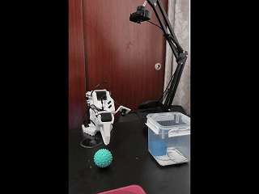
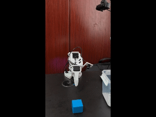
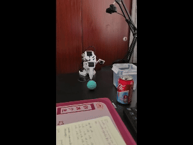
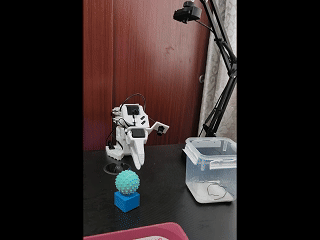

<div align="center">
  <h1>基于 Lerobot 和 SO-ARM101 机械臂学习 VLA</h1>
  <!-- <p><strong></strong></p> -->
  <!-- <p>基于 Lerobot 和 SO-ARM101 机械臂学习 VLA</p> -->

  <a href="https://github.com/yourname/explain_module"></a>
  <a href="https://github.com/yourname/explain_module"></a>
  <a href="https://github.com/yourname/explain_module"></a>
  <a href="https://github.com/yourname/explain_module"></a>
  <a href="https://github.com/yourname/explain_module"></a>
  <a href="https://github.com/yourname/explain_module"></a>
  <br>
  <!-- <a href="README_EN.md">English</a> -->
</div>

| ACT | SmolVLA | Pi0 | Pi05|
| --- | ---     | --- | --- |
|[](https://www.bilibili.com/video/BV1xt8w6oENF/?vd_source=d3c91656eb1a8e7284849bfdb83a2d61)|[](https://www.bilibili.com/video/BV1ek8r6SEH6/?spm_id_from=333.1387.upload.video_card.click&vd_source=d3c91656eb1a8e7284849bfdb83a2d61)|[](https://www.bilibili.com/video/BV12v876MEYH/?vd_source=d3c91656eb1a8e7284849bfdb83a2d61)|[](https://www.bilibili.com/video/BV1bB8Y6nEqx/?spm_id_from=333.1387.upload.video_card.click&vd_source=d3c91656eb1a8e7284849bfdb83a2d61) |

<p align="center">
  <a href="https://www.bilibili.com/video/BV1xt8w6oENF/?vd_source=d3c91656eb1a8e7284849bfdb83a2d61" target="_blank">
    <br>
    <b>ACT</b>
  </a>
  &nbsp;&nbsp;
  <a href="https://www.bilibili.com/video/BV1ek8r6SEH6/?spm_id_from=333.1387.upload.video_card.click&vd_source=d3c91656eb1a8e7284849bfdb83a2d61" target="_blank">
    <br>
    <b>SmolVLA</b>
  </a>
  &nbsp;&nbsp;
  <a href="https://www.bilibili.com/video/BV12v876MEYH/?vd_source=d3c91656eb1a8e7284849bfdb83a2d61" target="_blank">
    <br>
    <b>Pi0</b>
  </a>
  &nbsp;&nbsp;
  <a href="https://www.bilibili.com/video/BV1bB8Y6nEqx/?spm_id_from=333.1387.upload.video_card.click&vd_source=d3c91656eb1a8e7284849bfdb83a2d61" target="_blank">
    <br>
    <b>Pi05</b>
  </a>
</p>


## 硬件需求

### 机器人
淘宝京东可买，价格 2000 左右，可以自行搜索。建议自己买四根 USB 延长线(follower arm，leader arm，front camera，hand-eye camera)
- SO‑101 Follower arm ×1 (Feetech servo motors)
- SO‑101 Leader teleop arm ×1
- 2 × USB cameras (front view + hand‑eye view)
- 4 x USB extension cables($\leq 2\text{m}$)

---

### 相机规格
只是为了测试学习算法，相机也无需买特别好的，满足下述配置即可
- Resolution recommendation: 640×480, ≥30fps

---

### 主机配置

笔者使用 Lora 微调，训练模型所使用的远程服务器配置如下：<br>

| Type | Specifications |
|---|--|
|CPU| Intel(R) Xeon(R) Platinum 8347C CPU @ 2.10GHz |
|RAM| 64 G |
|GPU| 2 x 4090@24G
|||

笔者采集数据与模型推理所使用的本地设备配置如下：<br>
| Type | Specifications |
|---|--|
|CPU| Intel i914900kf |
|RAM| 32 G |
|GPU| 1 x 4080Ti@16G
|||

## 安装环境
使用 conda 或者 uv 配置环境都可以，二者选一, 不建议使用 wsl，推荐纯 windows 环境或者纯 Linux 环境。笔者的远程服务器是 ubuntu22.04，本地设备因为要玩游戏所以是 windows。环境的详细安装步骤参考下述链接：
> https://huggingface.co/docs/lerobot/installation

### conda 
```
conda create -y -n lerobot python=3.12
conda activate lerobot

git clone https://github.com/zyg519/lerobot_kit.git
cd lerobot_kit
pip install -e ".[all]"           # Everything (all policies, envs, hardware, dev tools)
```

### uv
```
git clone https://github.com/zyg519/lerobot_kit.git
cd lerobot_kit 

uv python install 3.12
uv venv --python 3.12

# Linux/macOS
source .venv/bin/activate
# Windows PowerShell
.venv\Scripts\activate

uv pip install -e ".[all]"           # Everything (all policies, envs, hardware, dev tools)
```

## 机械臂校准
校准之前需要将机械臂通过 usb 数据线连接至电脑，查询机器臂在设备上的 port 号，然后将脚本中的 port 号替换为实际的 port 号，Windows 和 Linux 下格式风格如下例所示：

```
# Windows
COM22

# Linux
/dev/ttyACM0
```

校准 SO101-Leader ARM
```
bash tools/calibration/01_calib_leader_arm.sh
```
校准过程中如果出现关节角度不在合理范围的报错，需要关闭校准，将关节掰到合适角度后再开始校准。<br>

校准 SO101-Follower ARM
```
bash tools/calibration/02_calib_follower_arm.sh
```

## launch.json 配置（调试用模板）
```
# train
{
    // Use IntelliSense to learn about possible attributes.
    // Hover to view descriptions of existing attributes.
    // For more information, visit: https://go.microsoft.com/fwlink/?linkid=830387
    "version": "0.2.0",
    "configurations": [

        {
            "name": "Python Debugger: Current File",
            "type": "debugpy",
            "request": "launch",
            "program": "${workspaceFolder}/src/lerobot/scripts/lerobot_xxxx.py",
            "console": "integratedTerminal",
            "cwd": "${workspaceFolder}",
            "justMyCode": false,
            "python": "${workspaceFolder}/.venv/bin/python",
            "env": {"PYTHONPATH": "${workspaceFolder}:${env:PYTHONPATH}", "HF_ENDPOINT": "https://hf-mirror.com"},
            "args": [
               ...
            ]
 
        }
    ]
}
```

## PEFT of VLA Algorithms
- [Pi0: A Vision-Language-Action Flow Model for General Robot Control](/tools/pi0/pi0_readme.md)
- [ACT: Learning Fine-Grained Bimanual Manipulation with
Low-Cost Hardware](/tools/act/act_readme.md)
- [SmolVLA: A vision-language-action model
for affordable and efficient robotics](/tools/smolvla/smolvla_readme.md)
- [Isaac GR00T N1.7 - Open Reasoning VLA model for Humanoid Robotics](/tools/gr00t/gr00t_readme.md)
- [π0.5: a Vision-Language-Action Model with Open-World Generalization](/tools/pi05/pi05_readme.md)